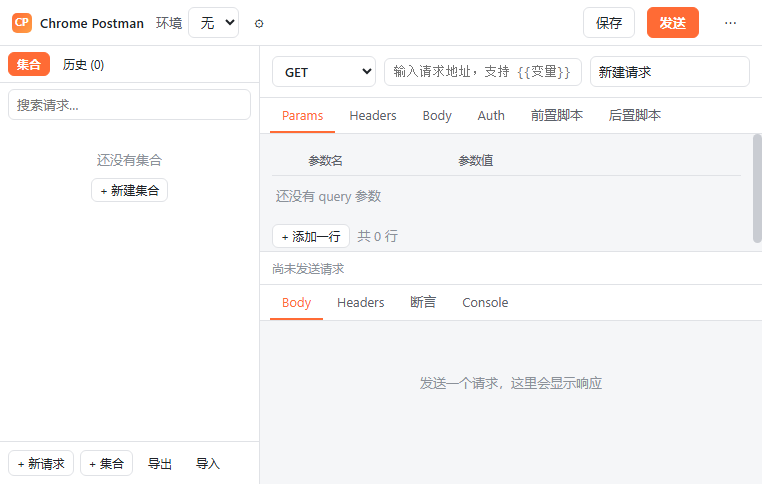

# Chrome Postman

基于 Chrome 扩展（Manifest V3）实现的类 Postman API 调试工具。



## 能力

| 分类 | 功能 |
|---|---|
| **请求** | 8 种方法、Query/Header 表格、6 种请求体格式（JSON/Text/XML/HTML/urlencoded/form-data/二进制）、5 种鉴权（none/basic/bearer/apikey/oauth2） |
| **拦截** | **前置脚本**（请求发出前改写 URL/方法/请求头/请求体）、**后置脚本**（响应返回后读响应、写断言、提取变量、改写响应） |
| **环境** | 多环境管理、环境变量/集合变量/全局变量/会话变量 4 层作用域、`{{var}}` 插值、4 个内置动态变量 |
| **组织** | 集合 → 文件夹 → 请求 树形管理、搜索、工作区导入导出 |
| **响应** | 状态码/耗时/大小/最终 URL、JSON 自动美化、响应头、断言结果、控制台日志 |
| **历史** | IndexedDB 持久化，可一键载入重放 |
| **输出** | 复制为 cURL、导出 HAR 1.2 |

## 技术要点

- **Manifest V3 + React 18 + TypeScript + Vite**
- **用户脚本跑在 QuickJS (WASM) 沙箱里** —— MV3 的 CSP 禁止 `eval`/`new Function`，WASM JS 引擎是官方认可的出路；沙箱内拿不到 DOM 与 `chrome.*`，并有 32MB 内存 / 5 秒超时限制
- **请求在 Service Worker 里发送** —— 面板关掉也能跑完；UI 与后台行为一致
- **执行器依赖注入** —— 核心逻辑不依赖 `chrome.*`，45 条单元测试在 Node 里直接跑

## 快速开始

```bash
npm install
npm run build:all          # 生成图标 + 构建（UI 与 Service Worker 分开构建）
```

然后：

1. 打开 `chrome://extensions`
2. 右上角开启 **开发者模式**
3. 点 **加载已解压的扩展程序**，选择本项目的 `dist/` 目录
4. 点击扩展图标 → **打开工作台**

## 常用命令

| 命令 | 作用 |
|---|---|
| `npm run build:all` | 生成图标 + 完整构建 |
| `npm run build` | 只构建（不重新生成图标） |
| `npm test` | 45 条单元测试（vitest） |
| `npm run typecheck` | TypeScript 类型检查 |
| `npm run pack` | 打包成 `release/chrome-postman-v1.0.0.zip` |
| `node scripts/e2e-verify.mjs` | 真实 Chrome 端到端验证（8 项检查） |

## GitHub Actions 自动发布

仓库内置两条流水线：

| 流水线 | 触发 | 做什么 |
|---|---|---|
| `.github/workflows/ci.yml` | push / PR 到 `main` | 类型检查 → 单元测试 → 构建 → 打包校验 → 上传 artifact |
| `.github/workflows/release.yml` | 推送 `v*` tag / 手动触发 | 同步版本号 → 类型检查 → 单元测试 → 构建 → 打包 → **创建 GitHub Release 并附 zip** |

发一个新版本：

```bash
npm run version:set -- v1.1.0    # 或者手动改 public/manifest.json
git commit -am "release: v1.1.0"
git tag v1.1.0
git push origin main --follow-tags
```

流水线会自动把 `manifest.json` 的版本号对齐到 tag，产出
`chrome-postman-v1.1.0.zip` 并挂到 Release 页面上。

也可以在 GitHub 页面手动触发：Actions → Release → Run workflow → 填版本号。

**首次发布（v1.0.0）已存在**：https://github.com/ZhSMM/chrome-postman/releases/tag/v1.0.0

> 打包脚本用 Node 内置 zlib 自己实现 ZIP 编码，不依赖 `tar` / `zip` / PowerShell。
> 原因是 GNU tar 的 `-a` 自动压缩**不支持 zip 格式**（只支持 gzip/bzip2/xz），
> 在 Linux CI 上会生成一个"后缀叫 .zip 的 tar"，装到 Chrome 里直接失败。

## 目录结构

```
chrome-postman/
├── public/
│   ├── manifest.json              # MV3 清单
│   └── icons/                     # 脚本生成的 PNG 图标
├── src/
│   ├── shared/                    # 跨层数据契约与纯工具
│   │   ├── types.ts               # 领域模型
│   │   ├── messages.ts            # UI ↔ SW 消息协议
│   │   └── utils.ts
│   ├── core/                      # 纯逻辑层（可单测）
│   │   ├── variables.ts           # 变量引擎
│   │   ├── pm-sdk.raw.js          # 沙箱内的 pm API（纯 JS 源码）
│   │   ├── sandbox.ts             # QuickJS 执行器
│   │   ├── request-executor.ts    # 请求执行管线（8 步）
│   │   ├── storage.ts             # chrome.storage 适配器
│   │   ├── db.ts                  # IndexedDB 历史
│   │   └── codelib.ts             # cURL / HAR
│   ├── background/
│   │   └── service-worker.ts      # 后台编排
│   ├── dashboard/                 # React 工作台
│   └── popup/                     # 图标弹窗
├── tests/                         # 45 条单元测试
├── scripts/                       # 构建 / 打包 / 验证脚本
└── docs/
    ├── DESIGN.md                  # v1.0/v1.1 设计文档（已实现）
    ├── DESIGN-v1.2.md             # v1.2 设计方案（SSL / 补全 / 易用与定位）
    ├── CHROME-API-REFERENCE.md    # Chrome API 详解（教学向）
    ├── USAGE-GUIDE.md             # 使用指南 + 脚本手册
    └── screenshots/
```

## 文档

- **[设计文档](./docs/DESIGN.md)** —— 架构、模块、数据流、关键技术决策与取舍
- **[v1.2 设计方案](./docs/DESIGN-v1.2.md)** —— SSL 验证与自签名证书方案、输入框智能补全、Postman 集合导入导出、耗时分段、变量高亮、错误行号定位。开篇有实测「事实基线」
- **[Chrome API 详解](./docs/CHROME-API-REFERENCE.md)** —— 每个 API 的参数表、示例与踩坑
- **[使用指南](./docs/USAGE-GUIDE.md)** —— 上手、脚本 API 手册、断言参考、FAQ

## 已知限制

- Digest 鉴权未实现
- 不支持浏览器全局流量拦截（MV3 平台限制，详见设计文档 §11）
- `pm.sendRequest()` 未实现（脚本内不能发起第二个请求）
- 会话变量存在 Service Worker 内存中，SW 休眠即丢失

## 隐私

无统计、无追踪、无远程上报。全部数据只存在本机 `chrome.storage.local` 与 IndexedDB。
