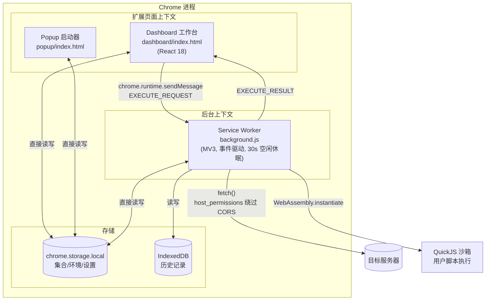
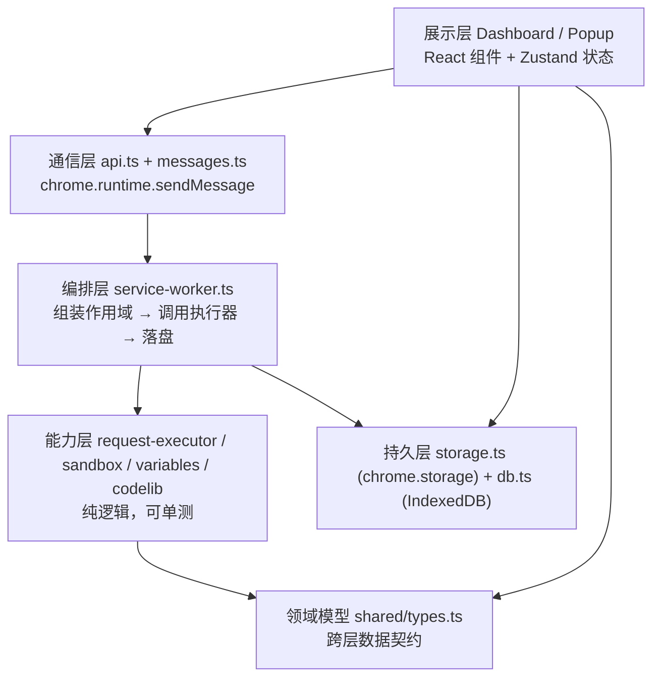
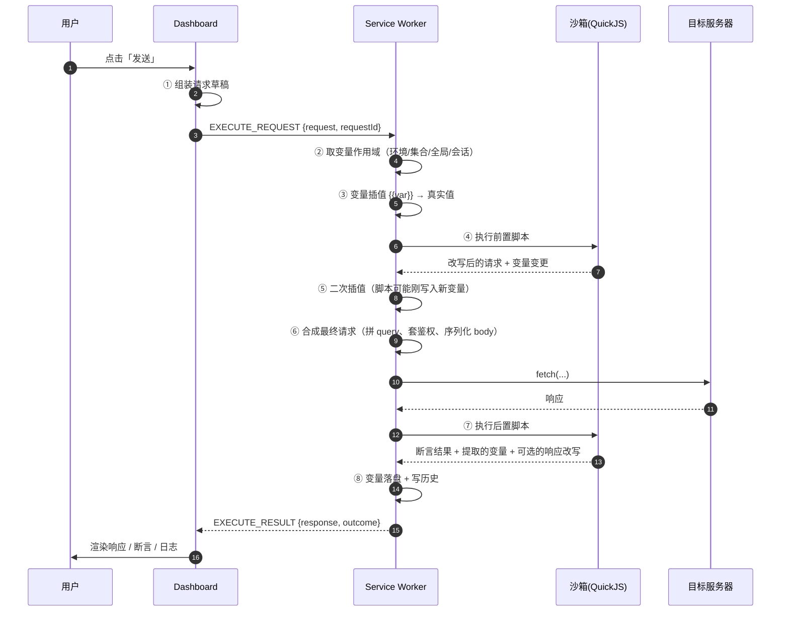
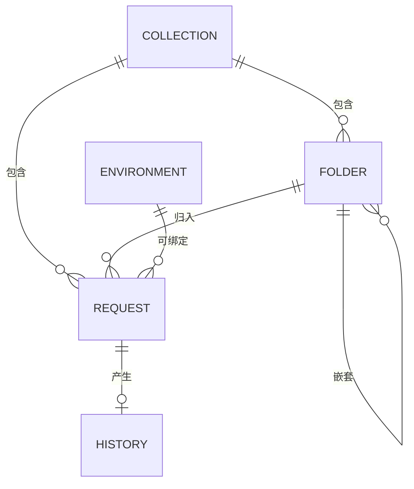
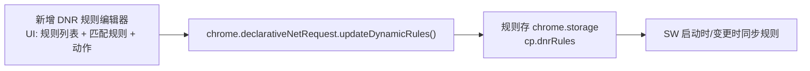
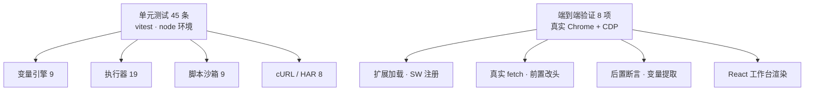
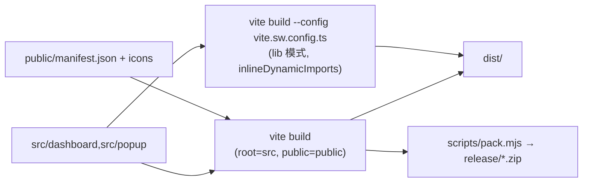

# Chrome Postman 设计文档

> 基于 Chrome 扩展（Manifest V3）实现的类 Postman API 调试工具
> 版本 1.0.0 · 技术栈 React 18 + TypeScript + Vite + QuickJS(WASM)

---

## 目录

1. [设计目标与范围](#1-设计目标与范围)
2. [需求拆解](#2-需求拆解)
3. [总体架构](#3-总体架构)
4. [关键时序：一次请求的完整生命周期](#4-关键时序一次请求的完整生命周期)
5. [模块设计](#5-模块设计)
6. [数据模型设计](#6-数据模型设计)
7. [存储设计](#7-存储设计)
8. [变量引擎设计](#8-变量引擎设计)
9. [脚本沙箱设计（核心）](#9-脚本沙箱设计核心)
10. [请求执行管线设计](#10-请求执行管线设计)
11. [「请求前后拦截」的语义边界](#11-请求前后拦截的语义边界)
12. [界面设计](#12-界面设计)
13. [权限、安全与隐私](#13-权限安全与隐私)
14. [测试策略与验证结果](#14-测试策略与验证结果)
15. [构建与发布](#15-构建与发布)
16. [已知限制与演进路线](#16-已知限制与演进路线)
17. [附录：想改 X 该动哪里](#17-附录想改-x-该动哪里)

---

## 1. 设计目标与范围

### 1.1 一句话定位

一个装在 Chrome 里的"接口调试工作台"：管理请求集合与环境变量，用变量消���环境差异，用前置/后置脚本在请求发出前后改写请求与响应，并用断言把调试结果固化下来。

### 1.2 设计原则

| 原则 | 具体含义 | 落地体现 |
|---|---|---|
| **能力对等** | 覆盖 Postman 的日常主链路：集合 / 环境 / 变量 / 脚本 / 断言 / 历史 | 见 §2.2 功能矩阵 |
| **拦截优先** | "改写请求与响应"是本工具的差异化能力，不是附属功能 | 脚本沙箱是一等公民（§9） |
| **可解释** | 每一次请求的最终 URL、请求头、耗时、断言结果都可见 | 响应面板 + Console 面板 + 错误翻译（§10.6） |
| **隔离** | 用户脚本不得触碰宿主能力 | QuickJS 沙箱，无 DOM / 无 chrome.*（§9.3） |
| **可验证** | 核心逻辑不依赖浏览器即可测 | 执行器依赖注入 + 45 条单测（§14） |

### 1.3 明确不做的事

- **不做浏览器全局流量拦截**（详见 §11）：MV3 平台能力有限，语义与 Postman 的"应用内拦截"不同，混在一起会误导用户。
- 不做 GraphQL 专用编辑器、Mock Server、WebSocket 客户端、gRPC。
- 不做账号体系与云端同步（工作区以 JSON 导入/导出方式迁移）。

---

## 2. 需求拆解

### 2.1 原始需求 → 设计映射

| 原始需求 | 拆解后的子需求 | 实现位置 |
|---|---|---|
| 实现核心能力 | ① HTTP 请求编辑与发送<br>② 集合/文件夹/请求的树形管理<br>③ 请求体多格式支持<br>④ 鉴权<br>⑤ 历史记录<br>⑥ cURL / HAR 导入导出 | `dashboard/`、`core/request-executor.ts`、`core/codelib.ts`、`core/db.ts` |
| 请求前后请求拦截 | ⑦ 前置脚本：改写 URL / 方法 / 请求头 / 请求体<br>⑧ 后置脚本：读响应、写断言、提取变量、改写响应 | `core/pm-sdk.raw.js`、`core/sandbox.ts` |
| 环境 | ⑨ 多环境管理<br>⑩ 环境变量与内置动态变量<br>⑪ 变量优先级与作用域 | `core/storage.ts`、`core/variables.ts`、`components/EnvManager.tsx` |

### 2.2 功能矩阵

```
核心能力
├── 请求
│   ├── 方法（8 种）、URL、Query、Header
│   ├── Body：none / json / text / xml / html / urlencoded / form-data / binary
│   ├── 鉴权：none / basic / bearer / apikey / oauth2（digest 明确提示未实现）
│   └── 发送：超时控制、重定向开关、Cookie 开关
├── 组织
│   ├── 集合 → 文件夹 → 请求（树形）
│   ├── 搜索过滤
│   └── 工作区导入 / 导出（JSON）
├── 变量
│   ├── 4 层作用域：环境 / 集合 / 全局 / 会话
│   ├── 内置动态变量：$timestamp $isoTimestamp $uuid $randomInt
│   └── {{var}} 插值 + 未解析变量标记
├── 脚本
│   ├── 前置脚本（请求前）
│   ├── 后置脚本（响应后）
│   ├── pm.* API（Postman 兼容子集）
│   ├── 断言 pm.test / pm.expect（迷你 chai）
│   └── console.log 日志
├── 响应
│   ├── 状态码 / 耗时 / 大小 / 最终 URL
│   ├── Body（JSON 自动美化）/ Headers / 断言 / Console
├── 历史
│   └── IndexedDB 持久化，可一键重放
└── 输出
    ├── 复制为 cURL
    └── 导出 HAR 1.2
```

---

## 3. 总体架构

### 3.1 运行时拓扑

MV3 扩展不是一个页面，而是一组**相互隔离的 JS 运行环境**。理解这一点是理解整个设计的前提。



**关键点**

1. **为什么请求在 Service Worker 里发**
   - 生命周期：用户切走标签页、收起面板、关闭工作台，请求照样跑完；
   - 单一事实源：UI 与后台不会跑出两套不同的请求行为；
   - 脚本沙箱在 SW 里执行，不受扩展页面 CSP 约束。

2. **为什么配置数据不经过 SW**
   `chrome.storage.local` 对所有扩展上下文可读写。集合、环境、设置由 UI 直接读写，SW 只在"脚本改写了变量"时回写。少一层消息往返，代码更简单。

3. **为什么历史单独放 IndexedDB**
   历史记录里含完整响应体，体积可能是 MB 级。`chrome.storage.local` 默认配额 10MB 且整键序列化读写，不适合高频追加的大对象。IndexedDB 是追加写 + 索引查询的原生场景。

### 3.2 分层结构



**依赖方向是单向的**：`shared/types.ts` 不依赖任何人；`core/*` 只依赖 `shared/*`；UI 依赖 core 与 shared。核心层**不含任何 `chrome.*` 调用**（除 storage/db 两个适配器），因此能在 Node 里直接单测。

---

## 4. 关键时序：一次请求的完整生命周期

这是本项目最核心的一条流程，共 8 步。



### 为什么需要第 ⑤ 步「二次插值」

这是最容易漏掉、但用户最需要的细节。典型场景：

```js
// 前置脚本
pm.environment.set('token', 'abc123');
```

```http
GET /api/users?token={{token}}
```

第 ③ 步插值时 `token` 还不存在，URL 里会留下 `{{token}}` 字面量，接口直接报 400。
第 ⑤ 步在前置脚本执行**之后**重新插值一次，`{{token}}` 这时才被替换成 `abc123`。

代码见 `src/core/request-executor.ts` 的 `reInterpolate()`。

---

## 5. 模块设计

### 5.1 文件职责一览

| 文件 | 职责 | 关键导出 |
|---|---|---|
| `src/shared/types.ts` | 领域模型与数据契约 | `HttpRequest` `Environment` `ExecutionResult` … |
| `src/shared/messages.ts` | UI ↔ SW 消息协议 | `MSG` 常量 |
| `src/shared/utils.ts` | 纯工具（URL 拆分、Base64、格式化） | `normalizeUrl` `toBlobBuffer` |
| `src/core/variables.ts` | 变量引擎：插值、作用域、动态变量 | `interpolate` `lookupVariable` `mergeScopes` |
| `src/core/pm-sdk.raw.js` | 沙箱内的 pm API（**纯 JS 字符串**） | 源码文本 |
| `src/core/sandbox.ts` | QuickJS 执行器：建上下文、注入状态、读回结果 | `runSandbox` |
| `src/core/request-executor.ts` | 请求执行管线（8 步） | `executeRequest` `resolveRequest` `composeRequest` |
| `src/core/storage.ts` | chrome.storage 适配器 + 工作区导入导出 | `getEnvironments` `exportWorkspace` |
| `src/core/db.ts` | IndexedDB 历史存储 | `addHistory` `listHistory` `pruneHistory` |
| `src/core/codelib.ts` | cURL / HAR 生成与解析 | `toCurl` `toHar` `fromHar` |
| `src/background/service-worker.ts` | 后台编排：消息路由、作用域组装、变量落盘、写历史 | — |
| `src/dashboard/*` | React 工作台 | `App` `store` 组件集 |
| `src/popup/main.tsx` | 图标弹窗（环境速切 + 入口） | — |

### 5.2 执行器的依赖注入

`request-executor.ts` 不直接调用全局 `fetch`，而是接受 `deps`：

```ts
export interface ExecuteDeps {
  fetchImpl?: typeof fetch;   // 网络实现
  now?: () => number;         // 时钟
  timeout?: number;
  followRedirects?: boolean;
  sendCookies?: boolean;
}
```

**为什么这么做**：单元测试里注入假 fetch，就能确定性地验证「插值 → 鉴权 → 脚本 → 请求 → 断言」的完整链路，不需要联网也不需要 Chrome 运行环境。同理，测试里注入固定时钟，耗时断言不会偶发失败。

---

## 6. 数据模型设计

### 6.1 实体关系



### 6.2 三个刻意的设计选择

**① 集合 / 文件夹 / 请求存成三张平表**

```ts
collections: Collection[]   // { id, name, variables[] }
folders:    Folder[]       // { id, name, collectionId, parentId }
requests:   HttpRequest[]  // { id, collectionId, folderId?, ... }
```

不用嵌套结构（`Collection.folders[].requests[]`）的原因：修改一个请求只需要重写 `requests` 这一张表；嵌套结构下改一个请求要重建整棵子树，并且 `chrome.storage` 每次 set 都是整值覆盖。代价是查询时要自己按 id 关联，代码里用 `filter` 完成，量级很小。

**② 键值对统一用 `KeyValue`**

```ts
interface KeyValue { id: string; key: string; value: string; enabled: boolean; description?: string }
```

Headers / Query / 环境变量 / 集合变量都用它，因为交互完全一致（表格 + 逐行启用开关 + 增删改）。`enabled` 对应 Postman 的"眼睛"图标：临时禁用一行而不删除它。

**③ 响应体统一存文本，二进制用 Base64 标记**

```ts
interface HttpResponseData {
  status: number; statusText: string;
  headers: Record<string, string>;
  body: string;         // 文本，或 Base64（isBase64=true）
  isBase64?: boolean;
  size: number;          // 字节数
  responseTime: number;  // 毫秒
  finalUrl?: string;
}
```

---

## 7. 存储设计

| 数据 | 存储介质 | Key / Store | 理由 |
|---|---|---|---|
| 集合、文件夹、请求 | chrome.storage.local | `cp.collections` / `cp.folders` / `cp.requests` | 结构化 JSON，需要跨上下文共享 |
| 环境 | chrome.storage.local | `cp.environments` | 同上 |
| 激活环境 id | chrome.storage.local | `cp.activeEnvironmentId` | 单独存，避免改环境列表时互相覆盖 |
| 全局变量 | chrome.storage.local | `cp.globals` | 全局变量是扁平 map |
| 设置 | chrome.storage.local | `cp.settings` | 读写频繁但体量小 |
| 历史记录 | IndexedDB `cp-history` / store `history` | keyPath `id`，索引 `timestamp` | 追加写 + 大对象 + 按时间倒序查 |

### 配额与持久化

- manifest 申请了 `unlimitedStorage`，解除 `chrome.storage.local` 的 10MB 限制（`unlimitedStorage` 只对 `storage.local` 与 IndexedDB 生效）。
- 历史记录在每次写入后调用 `pruneHistory(settings.historyLimit)`，默认保留最近 200 条，避免无限增长。
- `chrome.storage.local` 默认是**惰性落盘**的，对"关闭浏览器即丢"没有强要求的数据足够；如果将来要求"关闭浏览器也不丢"，需加 `chrome.storage.local.setAccessLevel({accessLevel: 'TRUSTED_CONTEXTS'})`。

---

## 8. 变量引擎设计

### 8.1 插值语法

```
{{变量名}}          普通变量
{{ 变量名 }}        允许空格
{{$timestamp}}      内置动态变量（$ 前缀）
```

规则：

- 未找到的变量**原样保留**（不替换为空串）。空串会让 URL 变成 `https://api./v1` 这种诡异形态；保留原样能一眼看出"这个变量没配"。未解析列表会随 `ResolvedRequest.missing` 返回，UI 可据此高亮。
- 支持一个字符串中出现多个占位符。
- 一次请求内会插值的位置：URL、Query 的键值、Header 的键值、Body 原文、Body 的表单字段、鉴权的全部字段。

### 8.2 作用域与优先级

| 作用域 | 存储位置 | 典型用途 |
|---|---|---|
| 环境 environment | chrome.storage（每个环境一份） | dev/test/prod 的域名、Token |
| 集合 collection | chrome.storage（每个集合一份） | 该集合共享的固定参数 |
| 全局 globals | chrome.storage（一份） | 所有环境共享的常量 |
| 会话 session | Service Worker 内存 | 脚本临时变量（SW 休眠即丢） |

**插值优先级（高 → 低）**：环境 > 集合 > 全局 > 会话

`pm.variables.get(key)` 的查找顺序是 **会话 > 环境 > 集合 > 全局**（会话级变量最具体，优先于任何持久化作用域），这与 Postman 的 local-first 语义一致。

### 8.3 内置动态变量

| 写法 | 含义 |
|---|---|
| `{{$timestamp}}` | 当前 Unix 时间戳（秒） |
| `{{$isoTimestamp}}` | 当前 ISO 8601 时间字符串 |
| `{{$uuid}}` / `{{$guid}}` | 随机 UUID v4 |
| `{{$randomInt}}` | 0~1000 随机整数 |

动态变量是**工厂函数**而非常量，因为每次求值必须给新值（`{{$randomInt}}` 每次都该不同）。

---

## 9. 脚本沙箱设计（核心）

### 9.1 问题定义

Postman 的核心卖点之一是"用户能写 JS 改请求"。在 Chrome 扩展里实现它，撞上一堵硬墙：

> **MV3 扩展页面的 CSP 是 `script-src 'self'`，禁止 `eval` 与 `new Function`。**

因此下面这些常见方案在 MV3 里全部不可用：

| 方案 | 为什么不行 |
|---|---|
| `new Function('pm', code)(pmApi)` | 扩展 CSP 禁止 unsafe-eval |
| `<iframe srcdoc>` + eval | srcdoc 文档继承父页面 CSP，同样被禁 |
| `<iframe src="data:text/html,...">` | data: URL 的脚本执行被 Chrome 拦截，且来源不透明 |
| `chrome.scripting.executeScript({func})` | `func` 必须是编译期就存在的函数对象，无法承载运行时字符串 |
| `chrome.userScripts` | 只能注入到网页上下文，且需用户在扩展详情页手动开启"允许用户脚本"，摩擦大 |

### 9.2 选定方案：QuickJS (WebAssembly)

把 QuickJS（一个用 C 写的 JS 引擎）编译成 WASM，在 WASM 沙箱里执行用户脚本。

| 优势 | 说明 |
|---|---|
| 不受扩展 CSP 限制 | 扩展页面允许 `'wasm-unsafe-eval'`（manifest 里已声明） |
| 真 JavaScript | 完整的 ES2020 语法：箭头函数、解构、`for...of`、模板字符串、`async` |
| 真沙箱 | 来宾代码只能看到显式注入的 `__state`，拿不到 `window` / `document` / `chrome.*` |
| 可控资源 | 内存上限 32MB、栈上限 1MB、执行超时 5 秒（死循环会被中断） |
| 无原生依赖 | 纯 WASM，无 Node API，浏览器/Node 双端可跑（单测直接用它） |

代价：`background.js` 体积约 774KB（其中 WASM 以 base64 内联）。Vite 的 lib 模式会自动把 WASM 资源内联成 data URL，因此 Service Worker 无需在运行时再 fetch 资源——这反而是最稳的形态（避免了扩展包内资源 MIME / 路径问题）。

### 9.3 沙箱边界

**注入宿主 → 沙箱**（一个 JSON 注入，无原生函数）：

```jsonc
{
  "request":  { "method": "...", "url": "...", "headers": [...], "body": {...}, "auth": {...} },
  "response": { "code": 200, "status": "OK", "headers": [...], "body": "...", "responseTime": 12, "size": 34 },
  "env":        { "token": "abc" },
  "collection": { ... },
  "globals":    { ... },
  "session":    { ... },
  "tests": [], "logs": []
}
```

**沙箱 → 宿主**：脚本直接改写 `__state`，执行结束后宿主一次性 `dump()` 读回。

**来宾拿不到的东西**（已由单测断言）：

| 能力 | 沙箱内取值 |
|---|---|
| `chrome` | `undefined` |
| `document` / `window` | `undefined` |
| `fetch` / `XMLHttpRequest` | 不可用 |
| 宿主文件系统 | 不可达 |
| 内存 | 受 32MB 限制 |
| CPU 时间 | 受 5 秒超时限制 |

### 9.4 pm API 契约

SDK 以**纯 JS 源码**形式（`src/core/pm-sdk.raw.js`）注入沙箱，在用户脚本之前执行。

**请求相关**

| API | 说明 |
|---|---|
| `pm.request.method` | 读写（get/set） |
| `pm.request.url.toString()` / `pm.request.url.raw` | 读写 URL |
| `pm.request.headers.add({name, value})` | 追加请求头 |
| `pm.request.headers.upsert({name, value})` | 有则改、无则加 |
| `pm.request.headers.remove(name)` | 删除（大小写不敏感） |
| `pm.request.headers.get(name)` / `.has(name)` / `.all()` / `.toObject()` | 查询 |
| `pm.request.body.raw` / `.mode` | 读写请求体 |
| `pm.request.body.toString()` / `.json()` | 读取请求体 |

**响应相关**

| API | 说明 |
|---|---|
| `pm.response.code` / `.status` | 状态码 / 状态文本 |
| `pm.response.responseTime` / `.size` | 耗时 / 大小 |
| `pm.response.headers.*` | 同请求头 API |
| `pm.response.json()` / `.text()` | 解析响应体（JSON 非法会抛错） |
| `pm.response.to.have.status(200)` | chai 风格断言入口 |

**变量相关**

| API | 说明 |
|---|---|
| `pm.environment.get/set/unset/has/clear/toObject` | 环境变量 |
| `pm.globals.get/set/...` | 全局变量 |
| `pm.variables.get/set/...` | 会话变量（读取时向外层兜底） |

**断言与日志**

| API | 说明 |
|---|---|
| `pm.test(name, fn)` | 注册一条断言，失败不会中断脚本 |
| `pm.expect(value)` | 返回迷你 chai 断言对象 |
| `console.log / warn / error` | 日志（收集到 Console 面板） |

**迷你 chai 支持的链**：`to` `be` `been` `is` `that` `which` `and` `has` `have` `with` `the` `not` `deep`，以及方法 `a/an` `equal/equals/eq` `eql` `include/contain/includes` `property` `status` `ok` `true` `false` `above/gt` `below/lt` `least/gte` `most/lte` `length` `match` `oneOf` `empty`。

### 9.5 执行流程与资源管理

```
getQuickJS()            // WASM 模块全局单例（加载约 200ms，只加载一次）
  └─ newContext()       // 每次脚本执行都新建独立上下文
       ├─ setMemoryLimit(32MB) / setMaxStackSize(1MB)
       ├─ setInterruptHandler(deadline)   // 超时中断
       ├─ evalCode(注入 __state)
       ├─ evalCode(pm SDK 源码)
       ├─ evalCode(用户脚本)
       └─ dump(__state) → 读回结果
  └─ context.dispose()  // 无论成败都释放，否则 WASM 堆持续增长
```

> 踩坑记录：quickjs-emscripten 0.32 的原生函数回调**只接收来宾参数**，不传 `this` 句柄；且 `newFunction` 必须在 **context** 上调用（不是 module 上），否则句柄属主（owner）不匹配会抛出 `Cannot read properties of undefined (reading 'owner')`。

---

## 10. 请求执行管线设计

### 10.1 八步管线

| 步 | 动作 | 失败处理 |
|---|---|---|
| ① 取作用域 | 读环境 / 集合 / 全局 / 会话变量 | 缺环境 → 该层为空对象 |
| ② 变量插值 | `{{var}}` → 真实值 | 未解析变量记入 `missing`，不报错 |
| ③ 前置脚本 | 沙箱执行，可改写请求 | 脚本异常被捕获，记入 `outcome.error`，**请求照常发出** |
| ④ 二次插值 | 用脚本写入后的新变量再插值一次 | — |
| ⑤ 合成请求 | 拼 query、套鉴权、序列化 body | JSON 非法 → 抛出可读错误并终止 |
| ⑥ 发起请求 | `fetch` + AbortController 超时 | 错误翻译成中文提示（§10.6） |
| ⑦ 后置脚本 | 沙箱执行，可读响应 / 写断言 / 提取变量 / 改写响应 | 同 ③ |
| ⑧ 落盘 | 变量写回 storage、历史写 IndexedDB | 失败只记日志，不影响本次结果 |

### 10.2 鉴权映射

| 类型 | 生成方式 |
|---|---|
| basic | `Authorization: Basic base64(user:pass)` |
| bearer | `Authorization: Bearer <token>` |
| oauth2 | `Authorization: Bearer <accessToken>` |
| apikey | 按 `apiKeyIn` 决定写进 Header 还是 Query |
| digest | **未实现**，UI 明确提示并引导改用 Bearer 或前置脚本手写 Authorization |

> Digest 需要与服务端做 challenge-response 往返，成本高、收益低；设计上选择"明确不支持"而不是"静默发错"。

### 10.3 请求体序列化

| 模式 | Content-Type | 序列化 |
|---|---|---|
| json | application/json | 原文字符串（先 `JSON.parse` 校验，非法直接报错） |
| text / xml / html | text/plain、application/xml、text/html | 原文字符串 |
| form-urlencoded | application/x-www-form-urlencoded | `URLSearchParams` |
| form-data | multipart/form-data（由浏览器生成 boundary） | `FormData` |
| binary | 按文件 MIME | `Blob` |

form-data **不能手动写 Content-Type**：boundary 由浏览器生成，手写会导致请求体无法被正确解析。

### 10.4 响应读取

- 按 `content-type` 判断是否二进制（`application/octet-stream`、`image/*`、`audio/*`、`video/*`、`application/pdf` 等）；
- 二进制转 Base64 并置 `isBase64 = true`；
- 耗时用注入的时钟测量（测试可固定）。

### 10.5 脚本对请求/响应的改写如何生效

| 阶段 | 脚本可改 | 生效方式 |
|---|---|---|
| 前置 | method / url / headers / body / auth | 覆盖 `ResolvedRequest` 对应字段后，再走 ⑤ 合成 |
| 后置 | code / status / headers / body | 覆盖 `HttpResponseData` 后返回给 UI 展示 |

### 10.6 错误翻译

网络层只给出 `Failed to fetch` 时，用户无从下手。本项目把它翻译成可执行建议：

```
请求失败：无法连接到 https://api.example.com/users。
可能原因：① 域名不存在或拼写错误；② 网络不通；③ 服务端拒绝跨域且扩展未获得该域名的访问权限；④ HTTPS 页面访问 HTTP 接口被浏览器拦截。
（原始错误：Failed to fetch）
```

超时单独识别为 `请求超时（30000 ms）`。

---

## 11. 「请求前后拦截」的语义边界

这是本设计中最需要明确的一节，因为它有两个完全不同的含义。

### 11.1 两种"拦截"

| | 应用内拦截（本项目实现） | 浏览器全局拦截（未实现） |
|---|---|---|
| 作用对象 | **本工具自己发出的请求** | 浏览器里**所有网页**发出的请求 |
| 实现方式 | QuickJS 沙箱里的前置/后置脚本 | `chrome.declarativeNetRequest` |
| 能改请求体吗 | ✅ 能 | ❌ 不能（只能改头/阻断/重定向） |
| 能改响应体吗 | ✅ 能 | ❌ 不能 |
| 能写断言吗 | ✅ 能 | ❌ 不能 |
| 平台限制 | 无 | MV3 下 `webRequestBlocking` 仅企业策略可用；DNR 只能匹配 URL/方法/资源类型/头，且无法读改响应体 |
| 语义 | 等价于 Postman 的 pre-request / tests | 等价于 Fiddler / Charles 的规则引擎 |

### 11.2 为什么本项目只做应用内

1. **DNR 改不了请求体和响应体**。而"拦截"最有价值的用法恰恰是动态签名、加密 body、字段改写——这些都必须能改 body。
2. **DNR 的匹配能力有限**。它只能基于 URL 正则、方法、资源类型、请求头做匹配，无法基于响应内容做判断（比如"拿到 token 后再决定是否重放"）。
3. **两条链路的用户心智不同**。Postman 用户要的是"改我要发的请求"，DNR 用户要的是"改所有流量"。混在一个 UI 里会让人误以为脚本能影响网页流量。

### 11.3 如果未来要加全局拦截

可行的增量路径（不与现有架构冲突）：



限制必须在 UI 上写清楚：**只能改请求头、阻断、重定向、修改响应头；不能改请求体与响应体**。若需要"改 body"，唯一出路是把流量导到本地代理（另起一个本地服务转发），属于另一个量级的工程。

---

## 12. 界面设计

### 12.1 布局

```
┌───────────────────────────────────────────────────────────────┐
│ Logo │ 环境选择 ▾ ⚙ │        保存 │ 发送 │ ⋯                 │ 46px
├────────────┬──────────────────────────────────────────────────┤
│ 集合 / 历史 │ GET ▾ │ URL 输入框（支持 {{变量}}）  │ 名称      │ 50px
│            ├──────────────────────────────────────────────────┤
│ 🔍 搜索     │ Params │ Headers │ Body │ Auth │ 前置脚本 │ 后置脚本│
│            │                                                  │
│ ▸ 集合A    │              请求编辑区（可滚动）                 │
│   ▸ 文件夹  │                                                  │
│     ● GET   ├──────────────────────────────────────────────────┤
│            │ 200 OK │ 12 ms │ 1.2 KB │ 断言 2/2 通过          │
│ + 新请求    │ Body │ Headers │ 断言 │ Console                  │
│ + 集合      │                                                  │
│ 导出/导入   │              响应区（可滚动）                     │
└────────────┴──────────────────────────────────────────────────┘
```

### 12.2 状态管理

选用 **Zustand** 而非 Redux：Redux 需要 action / reducer / dispatch 一整套样板，Zustand 用 hooks 风格，几十行管好一份全局状态，更适合工具型应用。

```
store.ts
├── 持久数据：collections / folders / requests / environments / activeEnvId / globals / settings
├── 运行数据：currentRequest / response / outcome / sending / history / toasts
└── 动作：bootstrap / selectRequest / save / send / CRUD / import / export / toast
```

### 12.3 主题

CSS 变量 + `data-theme` 属性。设置项支持「跟随系统 / 深色 / 浅色」，通过 `window.matchMedia('(prefers-color-scheme: light)')` 跟随系统。

### 12.4 编辑器选型

| 场景 | 组件 | 理由 |
|---|---|---|
| 脚本（前置/后置） | CodeMirror 6（`@uiw/react-codemirror` + JS 语言包） | 括号配对、语法高亮、缩进 |
| 请求体 | CodeMirror 6（按模式挂 JSON/XML/HTML 语言包） | JSON 需要高亮 |
| 键值表 | 自研 `KeyValueTable` | 交互特殊（逐行启用开关） |

---

## 13. 权限、安全与隐私

### 13.1 权限清单与理由

| 权限 | 理由 | 能否更小 |
|---|---|---|
| `storage` | 集合 / 环境 / 设置持久化 | 必需 |
| `unlimitedStorage` | 突破 10MB 配额 | 可选（数据量大时再申请） |
| `contextMenus` | 右键菜单"在此 URL 上发起请求" | 可选 |
| `host_permissions: <all_urls>` | 跨域发请求，绕过 CORS | **无法更小**：Postman 类工具必须能访问任意 API |

> Chrome Web Store 审核会重点关注 `<all_urls>`。发布时需要在商店页说明用途（本工具只向用户显式指定的 URL 发请求）。

### 13.2 安全边界

| 风险 | 缓解措施 |
|---|---|
| 用户脚本逃逸到宿主 | QuickJS 沙箱，无 DOM / 无 chrome.*；内存 32MB / 超时 5s |
| 脚本死循环卡死扩展 | Interrupt Handler 超时中断（已由单测覆盖） |
| 请求携带凭据外泄 | 请求只发往用户输入的地址；Cookie 开关默认开但可在设置里关 |
| 本地数据泄露 | 全部存在浏览器本地存储，不上传任何服务器，无网络回传 |
| 二进制响应撑爆内存 | 响应体上限未强制，但历史有 200 条裁剪；建议大响应谨慎 |

### 13.3 隐私

本扩展**不包含任何统计、追踪或远程上报代码**。所有数据（集合、环境、历史）只存在本机 `chrome.storage.local` 与 IndexedDB。工作区迁移通过用户主动导出的 JSON 文件完成。

---

## 14. 测试策略与验证结果

### 14.1 分层测试



### 14.2 单元测试（45 条，全部通过）

| 文件 | 条数 | 覆盖点 |
|---|---|---|
| `tests/variables.test.ts` | 9 | 插值、优先级、未解析保留、动态变量、作用域合并 |
| `tests/executor.test.ts` | 19 | 插值、鉴权映射、body 序列化、前置改写、二次插值、后置断言、变量提取、超时、网络错误翻译 |
| `tests/sandbox.test.ts` | 9 | pm API 读写、断言通过/失败、console 收集、异常捕获、死循环超时、**沙箱隔离（无 chrome/DOM）** |
| `tests/codelib.test.ts` | 8 | cURL 生成与转义、HAR 结构、HAR 反解 |

### 14.3 端到端验证（8 项，全部通过）

`scripts/e2e-verify.mjs` 用 DevTools Protocol 驱动真实 Chrome：

```
[4/5] extension loaded: Chrome Postman (omlahmjilggggldidpilcbepbobbfbpp)
    dashboard probe: {"title":"Chrome Postman 工作台","header":true,"sidebar":true,
                      "urlInput":true,"sendBtn":true,"rootChildren":1}

=== E2E RESULT ===
response status : 200
response body   : {"ok":true,"path":"/e2e?trace=1","method":"POST",
                   "token":"from-script","auth":"Bearer e2e-token"}
tests           : [{"name":"status is 200","passed":true},{"name":"body ok","passed":true}]
script vars     : {"environment":{"scratch":"ok","gotPath":"/e2e?trace=1"}}

PASS  React 工作台已渲染
PASS  Service Worker 响应消息
PASS  请求真的发出并拿到 200
PASS  前置脚本注入的 X-Token 生效
PASS  Bearer 鉴权头生效
PASS  后置脚本断言全部通过
PASS  后置脚本提取的变量存在
PASS  无脚本错误
```

这条链路同时证明了：**manifest 可加载、SW 可注册、消息通道通、WASM 沙箱在真实 MV3 Service Worker 内可执行、网络请求可发出**。

> 踩坑记录：Google Chrome 品牌版从 137 起禁用了命令行 `--load-extension`（日志明确打印 `is not allowed in Google Chrome, ignoring.`）。自动化验证必须走 DevTools Protocol 的 `Extensions.loadUnpacked` + `Extensions.getExtensions`（Chrome 156 已提供该域）。

---

## 15. 构建与发布

### 15.1 构建管线



**为什么 Service Worker 要单独构建**：MV3 的 SW 是单文件入口，manifest 里写死一个路径，不能依赖代码分块。因此用 lib 模式 + `inlineDynamicImports` 把所有依赖（含 WASM）打进单个 `background.js`。构建顺序必须是 **先 UI 后 SW**，因为 UI 构建会清空 `dist/`。

### 15.2 本地加载

```
chrome://extensions → 开启「开发者模式」→「加载已解压的扩展程序」→ 选择 dist/
```

### 15.3 发布前检查清单

- [ ] `npm run typecheck` 无错误
- [ ] `npm test` 全绿
- [ ] `npm run build:all` 成功，`dist/manifest.json` 存在
- [ ] `node scripts/pack.mjs` 打包成功
- [ ] `node scripts/e2e-verify.mjs` 8 项全过
- [ ] 商店页说明 `<all_urls>` 权限用途
- [ ] 隐私政策声明"数据仅存本地"

---

## 16. 已知限制与演进路线

### 16.1 当前限制

| 限制 | 原因 | 影响 |
|---|---|---|
| Digest 鉴权未实现 | 需 challenge-response 往返 | 少数老接口 |
| 无 WebSocket / GraphQL / gRPC 客户端 | 工程量 | 高级协议场景 |
| 无 Mock Server | 需要常驻本地服务 | 服务端 mock 场景 |
| 无云端同步 | 避免引入账号体系与隐私负担 | 多设备协作 |
| `pm.sendRequest()` 未实现 | 需要宿主异步回调桥接 | 脚本内发起第二个请求 |
| 响应体无大小上限 | 未做保护 | 超大响应可能占用较多内存 |
| 会话变量随 SW 休眠丢失 | MV3 SW 生命周期特性 | 长期 token 应写进环境 |

### 16.2 演进路线（按性价比排序）

1. **`pm.sendRequest()`** —— 在 `sandbox.ts` 增加一个可 await 的宿主回调（QuickJS 支持 Promise + `executePendingJobs`），让脚本能串联多个请求。这是 Postman 用户的高频需求。
2. **响应体大小上限** —— 给 `executeRequest` 加 `maxResponseBytes`，超出截断并标记。
3. **集合级 Pre-request / Post-response 脚本** —— Postman 支持在集合上挂脚本，自动应用到所有请求。
4. **侧边栏模式（side panel）** —— 目前只有 Popup 入口，做一个 `side_panel` 页面可以边调接口边看网页。
5. **HAR 导入** —— `fromHar` 已实现解析，补一个 UI 导入入口即可。
6. **DNR 全局规则**（如 §11.3）—— 作为独立功能模块，与应用内拦截明确区分。

---

## 17. 附录：想改 X 该动哪里

| 想做的事 | 要改的文件 | 关键位置 |
|---|---|---|
| 加一种 HTTP 方法 | `src/dashboard/App.tsx` | `METHODS` 数组 |
| 加一种请求体模式 | `src/shared/types.ts` → `BodyMode`<br/>`src/dashboard/components/BodyEditor.tsx` → `MODES`<br/>`src/core/request-executor.ts` → `composeRequest` 的 switch | 三处都要改（类型 / UI / 序列化） |
| 加一种鉴权类型 | `src/shared/types.ts` → `AuthType`<br/>`src/dashboard/components/RequestEditor.tsx` → `AUTH_TYPES`<br/>`src/core/request-executor.ts` → `composeRequest` 的 switch<br/>`src/core/codelib.ts` → `toCurl` | 四处 |
| 加一个 pm API | `src/core/pm-sdk.raw.js` | 在 `pm` 对象里加方法即可；新增能力若需宿主数据，用 `__state` 扩展注入 |
| 加一个断言方法 | `src/core/pm-sdk.raw.js` → `Assertion.prototype` | 注意链式词（`to`/`be`…）不能重复定义成方法 |
| 改变量优先级 | `src/core/variables.ts` → `lookupVariable` | 顺序即优先级 |
| 加内置动态变量 | `src/core/variables.ts` → `dynamicFactories` | 用工厂函数，不用常量 |
| 改请求超时默认值 | `src/core/request-executor.ts` → `executeRequest` 的 `deps.timeout ?? 30000`<br/>`src/shared/types.ts` → `DEFAULT_SETTINGS.timeout` | 运行时默认值 + 设置项默认值 |
| 加一个新的持久化字段 | `src/shared/types.ts` → 对应实体<br/>`src/core/storage.ts` → `STORAGE_KEYS` + 读写函数 | 旧数据没有该字段时要给默认值（见 `getSettings`） |
| 改历史保留条数 | `src/dashboard/components/App.tsx` → 设置弹窗<br/>`src/shared/types.ts` → `DEFAULT_SETTINGS.historyLimit` | 写入后会自动裁剪 |
| 改 UI 布局 | `src/dashboard/App.tsx` + `src/dashboard/styles.css` | 布局骨架在 App，样式全部用 CSS 变量 |
| 改主题色 | `src/dashboard/styles.css` → `:root` 的 `--accent` 等变量 | 改一处全局生效 |
| 加全局拦截（DNR） | 新建 `src/core/dnr.ts` + `src/dashboard/components/DnrEditor.tsx`<br/>manifest 加 `declarativeNetRequest` 权限 | 见 §11.3 的路径图 |
| 让脚本能发第二个请求 | `src/core/sandbox.ts`（加 Promise 宿主回调）<br/>`src/core/pm-sdk.raw.js`（加 `pm.sendRequest`） | QuickJS 需 `executePendingJobs` |
| 改图标 | `scripts/gen-icons.mjs` → `BOLT` 多边形 / 颜色 | 然后 `npm run icons` |

---

### 自测题（用来确认你真的读懂了设计）

1. 为什么请求要放在 Service Worker 里发，而不是在 Dashboard 页面里发？各有什么代价？
2. 为什么第 ④ 步"二次插值"不能省？举一个省掉就会出错的例子。
3. MV3 里为什么不能用 `new Function` 跑用户脚本？本项目的替代方案是什么，它的代价是什么？
4. 前置脚本修改了 `pm.request.headers`，这个改动是在哪一步真正生效的？
5. `pm.variables.get()` 的查找顺序和 `{{var}}` 的插值顺序为什么不一样？这样设计合理吗？
6. 如果要让脚本同时修改请求体和响应体，MV3 的 `declarativeNetRequest` 能不能做到？为什么？
7. 为什么历史记录放 IndexedDB 而不是 `chrome.storage.local`？
8. 变量优先级里，环境高于会话；如果反过来会导致什么用户体验问题？

---

*文档随代码同步维护。代码位置：src/；测试位置：tests/；验证脚本：scripts/。*
